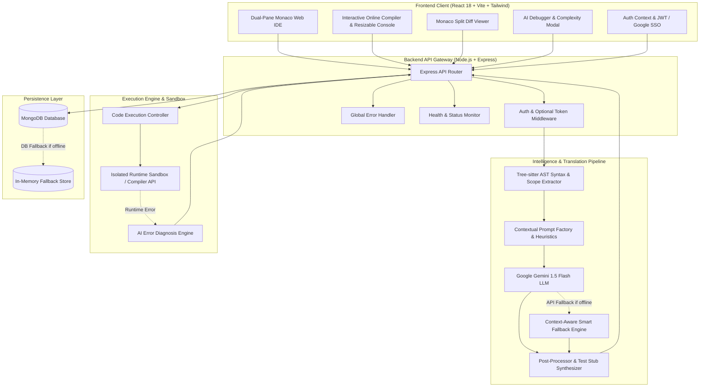
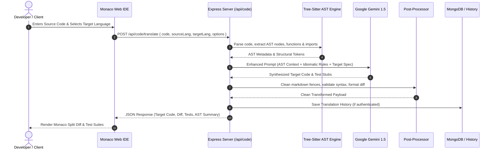
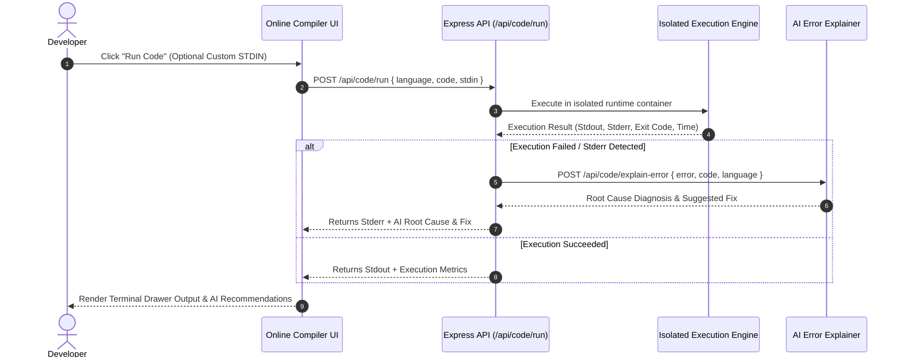

# 🚀 Smart Code Translator & Developer Workbench

[](https://opensource.org/licenses/MIT)
[](https://nodejs.org/)
[](https://react.dev/)
[](https://deepmind.google/technologies/gemini/)
[](https://vitejs.dev/)
[](https://microsoft.github.io/monaco-editor/)

An enterprise-grade, full-stack developer platform that seamlessly converts source code across multiple programming languages (**Python, JavaScript, TypeScript, Java, C++, Go**) while preserving semantic logic, idiomatic best practices, and type safety.

Equipped with an **Interactive Online Compiler**, **AI Error Debugger**, **Time & Space Complexity Analyzer**, **Automated Test Generator**, and **Monaco Split Diff Viewer**.

---

## 🏗️ System Architecture & Data Flow

### 1. High-Level Architecture Flowchart



---

### 2. End-to-End Translation Sequence Flow



---

### 3. Online Compiler & AI Debugger Execution Flow



---

## 🌟 Key Features & Capabilities

- 🔄 **AST-Aware Multi-Language Code Translation**:
  - Leverages **Tree-sitter** syntax trees to extract functions, classes, scopes, imports, and docstrings.
  - Translates seamlessly between **Python, JavaScript, TypeScript, Java, C++, and Go**.
  - Maps language-specific idioms accurately (e.g., Python `asyncio` $\leftrightarrow$ JavaScript `Promise.all()`, Python `dict.get()` $\leftrightarrow$ TypeScript `?.`, Go `if err != nil` $\leftrightarrow$ modern `try/catch`).

- ⚡ **Interactive Online Compiler Workbench**:
  - Multi-language interactive sandbox supporting Python, JS, TS, Java, C++, and Go.
  - Custom STDIN input support for interactive console applications.
  - **Draggable, Resizable Terminal Drawer** with smooth mouse drag, collapse/expand toggles, and formatted stdout/stderr console output.

- 🧠 **AI Debugger & Error Explainer**:
  - Automatically intercepts execution errors and runtime stack traces.
  - Dissects compiler errors with root cause explanations and ready-to-apply fixes.

- 📊 **Time & Space Complexity Analyzer**:
  - Inspects code algorithms to compute Big-O Time and Space complexity ($O(1)$, $O(\log n)$, $O(n)$, $O(n^2)$).
  - Flags potential performance bottlenecks, memory leaks, and antipatterns.

- 🚀 **Automated Code Optimizer**:
  - Refactors code for modern runtime performance, memory efficiency, and cleaner idioms.

- 🪟 **Monaco Split Diff Viewer**:
  - Side-by-side visual diff comparison between original source code and translated code using Monaco Editor.

- 🧪 **Automated Test Stub Generator**:
  - Automatically synthesizes unit test stubs for the target language (PyTest, Vitest/Jest, JUnit, Go `testing`).

- 💻 **Terminal CLI Batch Translator**:
  - Standalone command-line utility with flags for file input/output, comments preservation, and unit test generation.

- 🔐 **Authentication & History Tracking**:
  - JWT Authentication, Google OAuth SSO, and anonymous guest mode.
  - Cloud translation history saved with instant rollback and copy support.

---

## 🛠️ Project Structure

```
smart-code-translator/
├── client/                          # React Frontend (Vite + Monaco Editor + Tailwind CSS)
│   ├── src/
│   │   ├── components/              # UI Components
│   │   │   ├── MonacoEditor.jsx     # Side-by-side Monaco translation editor
│   │   │   ├── OnlineCompiler.jsx   # Interactive execution workbench with resizable terminal
│   │   │   ├── DiffViewer.jsx       # Monaco visual diff viewer
│   │   │   ├── HistoryPanel.jsx     # Translation and execution history drawer
│   │   │   ├── AnalysisModal.jsx    # Big-O complexity & code health modal
│   │   │   ├── Navbar.jsx           # Top navigation bar & theme controls
│   │   │   ├── AuthModal.jsx        # Login & Signup modal with Google SSO
│   │   │   └── ErrorBoundary.jsx    # Production UI fallback boundary
│   │   ├── context/                 # AuthContext.jsx (Authentication state)
│   │   ├── services/                # api.js (Axios client with interceptors)
│   │   ├── App.jsx                  # Main view router & tab coordinator
│   │   └── index.css                # Custom glassmorphism styles & resizer styling
│   ├── nginx.conf                   # Nginx reverse proxy configuration
│   ├── vercel.json                  # Vercel deployment rewrites
│   └── package.json
├── server/                          # Express Backend (Tree-sitter AST + Gemini SDK)
│   ├── config/                      # db.js (MongoDB Mongoose + In-Memory Fallback)
│   ├── controllers/                 # codeController.js, runController.js, authController.js
│   ├── middleware/                  # authMiddleware.js, errorHandler.js
│   ├── models/                      # User.js, TranslationHistory.js
│   ├── routes/                      # authRoutes.js, codeRoutes.js, historyRoutes.js
│   ├── services/                    # treeSitterService.js, llmService.js, promptFactory.js, postProcessor.js
│   ├── Dockerfile                   # Docker container definition
│   ├── server.js                    # Express application entrypoint
│   └── package.json
├── cli/                             # Terminal CLI Batch Tool
│   ├── bin/                         # smart-translate.js (CLI binary entrypoint)
│   ├── index.js                     # CLI argument parser & translator client
│   └── package.json
├── render.yaml                      # Render Blueprint configuration
├── .env.example                     # Environment template
└── README.md
```

---

## ⚡ Quick Start & Installation

### Prerequisites
- **Node.js**: v18.0.0 or higher
- **npm** or **yarn**
- *(Optional)* **MongoDB** instance (falls back automatically to in-memory store if omitted)
- *(Optional)* **Google Gemini API Key** (falls back to built-in heuristic translator if omitted)

---

### 1. Backend Server Setup (`server/`)

```bash
cd server
npm install
```

Create a `.env` file in `server/` (or copy from `.env.example`):
```env
PORT=5000
MONGODB_URI=mongodb://localhost:27017/smart-code-translator
JWT_SECRET=your_jwt_secret_key_here
GEMINI_API_KEY=your_gemini_api_key_here
CLIENT_URL=http://localhost:3000
```

Start the backend:
```bash
npm start
# or for live reloading:
npm run dev
```
> The API server will be available at `http://localhost:5000`.

---

### 2. Frontend Dual-Pane IDE (`client/`)

```bash
cd client
npm install
npm run dev
```
> The application will open at `http://localhost:3000`.

---

### 3. Terminal CLI Batch Translator (`cli/`)

```bash
cd cli
npm install

# Translate a Python file to TypeScript with unit test stubs:
node index.js --source python --target typescript --input ./sample.py --output ./sample.ts --test

# Run help command:
node index.js --help
```

---

## 📡 API Reference

### Authentication Endpoints
| Method | Endpoint | Description |
|---|---|---|
| `POST` | `/api/auth/register` | Register new user account with email & password |
| `POST` | `/api/auth/login` | Authenticate user and receive JWT bearer token |
| `POST` | `/api/auth/google` | Authenticate via Google OAuth SSO token |

### Code & Execution Endpoints
| Method | Endpoint | Description |
|---|---|---|
| `POST` | `/api/code/translate` | Translates code with AST context, generates test stubs & diff |
| `POST` | `/api/code/analyze` | Generates Time & Space Big-O complexity & code health diagnostics |
| `POST` | `/api/code/optimize` | Refactors code for modern syntax, efficiency, and idioms |
| `POST` | `/api/code/run` | Executes code in isolated sandbox with custom STDIN |
| `POST` | `/api/code/explain-error` | Diagnoses runtime or compilation errors with AI root-cause analysis |
| `GET` | `/api/code/gemini-status` | Returns whether the Gemini AI service is connected and ready |

### History & System Endpoints
| Method | Endpoint | Description |
|---|---|---|
| `GET` | `/api/history` | Fetches historical translations for the authenticated user |
| `DELETE` | `/api/history/:id` | Deletes a translation record |
| `GET` | `/api/health` | System health check and uptime status |

---

## 🚀 Deployment

### Deploy to Render (Backend)
The project includes a root `render.yaml` blueprint:
1. Connect your GitHub repository to [Render](https://render.com/).
2. Select **New Blueprint Instance**.
3. Set the environment variables (`GEMINI_API_KEY`, `MONGODB_URI`, `JWT_SECRET`).

### Deploy to Vercel (Frontend)
The frontend contains `client/vercel.json` with API rewrites:
1. Import the `/client` directory on [Vercel](https://vercel.com/).
2. Set `VITE_API_BASE_URL` to your live Render backend URL.
3. Deploy!

---

## 📄 License

This project is licensed under the [MIT License](LICENSE).
